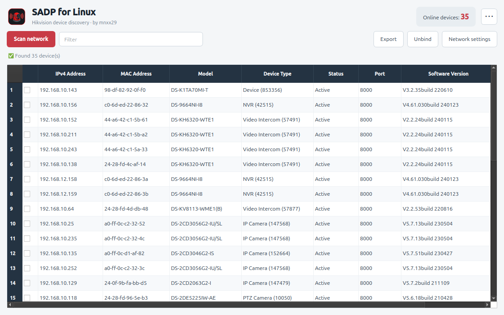

# Hikvision SADP GUI for Linux

**English** | [Español](README_es.md)

Native Python/PyQt6 discovery for Hikvision-compatible devices on a local network. The GUI discovers devices, filters and sorts results, preserves custom model labels, and exports CSV reports including serial numbers.



The interface has its own charcoal/red styling. Change the language from `⋯ → Language`; the choice is saved automatically.

## Requirements and validation

- Python **3.9+**, PyQt6 **6.4+**, Linux with IPv4 networking and `iproute2`.
- The packaged helper is **Linux amd64**. Other architectures require a separate helper build.
- The test environment is **Ubuntu Desktop 24.04 LTS amd64**. Debian 12 and other distributions are not certified by this release's VM tests.
- Devices must share a reachable layer-2 segment with a probed interface. Different device IP subnets on the same segment are supported; this does not automatically cross routers or VLAN boundaries.
- Building from source needs Git, `dpkg-dev`, and Go **1.21+** as a bootstrap. The build downloads and uses the exact toolchain in [packaging/upstream.env](packaging/upstream.env). Go is not required to run a release package.

## Install

Download a `.deb` from [Releases](https://github.com/Mnxx29/Hikvision-SADP-GUI-Linux/releases), then:

```bash
sudo apt install ./hikvision-sadp-gui_1.0.4_amd64.deb
sadp-gui
```

Verify downloads against the `SHA256SUMS.txt` supplied with each release.

The application is installed in `/opt/hikvision-sadp`, with `/usr/bin/sadp-gui` and a desktop menu entry. Run the GUI as your normal user.

For the tarball, first install Python/PyQt6 and networking dependencies through your distribution. Extract the bundle, then run `sudo bash install.sh`. Do not mix tarball and Debian installations. To remove it, run the bundle's `sudo bash uninstall.sh`.

### From source (Debian/Ubuntu)

```bash
git clone https://github.com/Mnxx29/Hikvision-SADP-GUI-Linux.git
cd Hikvision-SADP-GUI-Linux
bash setup-produccion.sh
```

This builds the pinned helper and installs the same Debian package, using sudo for package installation. It retires the older per-user launchers that would shadow the system launcher. The old `~/.local/bin/sadp` directory can be removed with `clean-install.sh` after migrating.

## Network permissions and removal

Installation needs root; starting and scanning do not. Version 1.0.3 removes `/etc/sudoers.d/sadp-gui-routing` from 1.0.2 and creates no passwordless sudoers rule or raw-socket capability.

The installer sets only `net.ipv4.conf.all.rp_filter=2` and `net.ipv4.conf.default.rp_filter=2` in `/etc/sysctl.d/60-hikvision-sadp.conf`. Original runtime values are recorded in `/var/lib/hikvision-sadp/network-state.json` and retained across upgrades. These are system-wide reverse-path-filter settings; they allow asymmetric replies while retaining loose reverse-path validation.

If UFW is already active and has no existing SADP policy, the installer adds SADP rules for UDP destination port 37020, UDP replies from source port 37020 (the helper uses ephemeral local ports), and outbound multicast to `239.255.255.250:37020`. It **never enables UFW**. Existing administrator SADP rules are preserved without relabelling or broadening them; the installer asks you to review that policy instead. If UFW is enabled later, explicitly rerun `sudo python3 /opt/hikvision-sadp/network_setup.py configure`. Other firewalls need equivalent administrator configuration.

```bash
sudo apt remove hikvision-sadp-gui
```

Removal restores tracked kernel values when they still equal the installed value, removes its unmodified sysctl file, and deletes only UFW rules added by this version. Administrator changes are preserved. Rules left by 1.0.2 are retained: that version did not record their ownership. An administrator can inspect them with `sudo ufw show added`.

## Supported operations and limits

Discovery is implemented in [sadp_discover.py](sadp_discover.py). The reviewed Go helper handles network changes and Hik-Connect/Ezviz unbind. Its source commit and compiler are pinned; its MIT license is included in the bundles.

- Supported modification fields: IPv4 address, dotted contiguous subnet mask, gateway, SDK port and DHCP.
- HTTP, IPv6 and Hik-Connect enablement controls remain disabled. Model edits are local labels, not device configuration.
- A command succeeds only with helper exit code zero and an explicit matching SADP acknowledgement. Unknown replies and timeouts are **unconfirmed**; scan and check the device before retrying. State-changing commands are not automatically resent.
- Real-device network modification and unbind need separate hardware validation. Discovery success does not certify those features or every firmware's result codes.
- Password reset is not implemented; the GUI explains the external support workflow.

## Diagnostics and development

```bash
bash diagnostico.sh
python3 sadp_discover.py --timeout 6 --debug
python3 sadp_discover.py --timeout 6 --csv > devices.csv
```

Diagnostics inspect configuration and send discovery probes; they do not change routes, firewall or kernel settings. CSV stdout is machine-readable; debug output goes to stderr in CSV mode.

See [CONTRIBUTING.md](CONTRIBUTING.md), [CHANGELOG.md](CHANGELOG.md) and [validation notes](docs/validation-1.0.3.md).

## Disclaimer and license

Independent community project, not affiliated with or endorsed by Hikvision. Hikvision, EZVIZ, Hik-Connect and SADP belong to their respective owners and identify compatible equipment.

GUI code: [MIT](LICENSE). The packaged `hikvision-tooling` helper includes its own MIT copyright notice.
